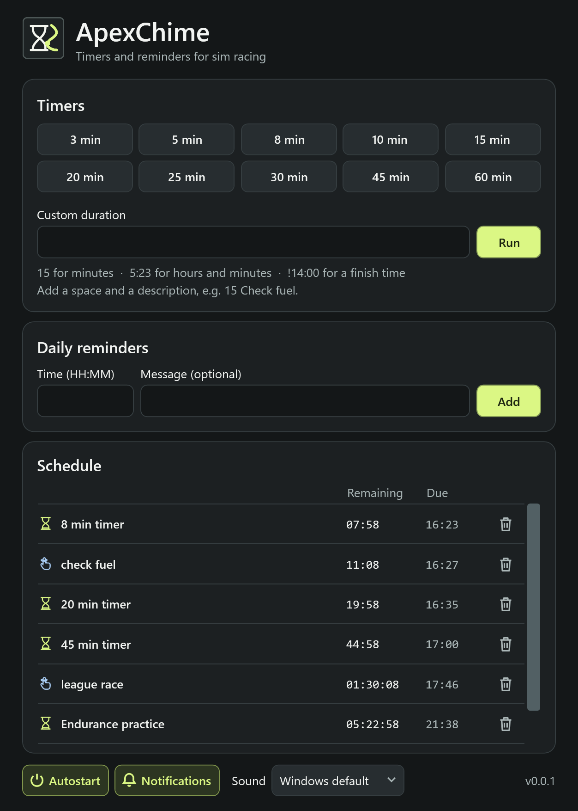

# ApexChime

ApexChime is a portable Windows 11 app for sim racing timers and daily reminders.



## Run

Download the artifact for your Windows architecture from the latest successful GitHub Actions build. Extract it and open `ApexChime.exe`. The executable includes its .NET runtime.

- Click a preset to start a timer immediately. For a custom timer, use `15` for 15 minutes, `5:23` for 5 hours and 23 minutes, or `!14:00` to finish at the next 14:00. Add a description after a space, as in `15 Check fuel`. Timers can run for up to 24 hours.
- Add a daily reminder with an optional message.
- Closing the window keeps ApexChime running in the Windows notification area. Double-click its icon to reopen it, or use **Exit** in the icon's context menu to quit.

Alerts play the selected sound once and show a translucent banner near the bottom-right of the active monitor for 15 seconds. The banner lets clicks pass through and keeps keyboard focus in the game. Use windowed or borderless mode to see banners while playing. Overlapping alerts share a banner with a count. **Notifications** controls both the banner and sound. Choose a sound to preview it. **No sound** keeps the banner visible and mutes audio.

**Autostart** is off by default. When enabled, ApexChime starts in the notification area at Windows sign-in. If the executable is moved, toggle **Autostart** off and on to update the path.

## Build

Install the [.NET 10 SDK for Windows](https://dotnet.microsoft.com/en-us/download/dotnet/10.0). Choose the SDK that matches your development machine. From the repository root in PowerShell, run:

```powershell
.\build.ps1
# For native Windows on Arm:
.\build.ps1 -Architecture arm64
```

The script writes `dist/win-x64/ApexChime.exe` or `dist/win-arm64/ApexChime.exe`. GitHub Actions builds both architectures and uploads each executable as an artifact.

## License

MIT. See [LICENSE](LICENSE).

The bundled [Interface Sounds by Kenney](https://kenney.nl/assets/interface-sounds) are provided under [CC0 1.0](Assets/Sounds/LICENSE.txt).
